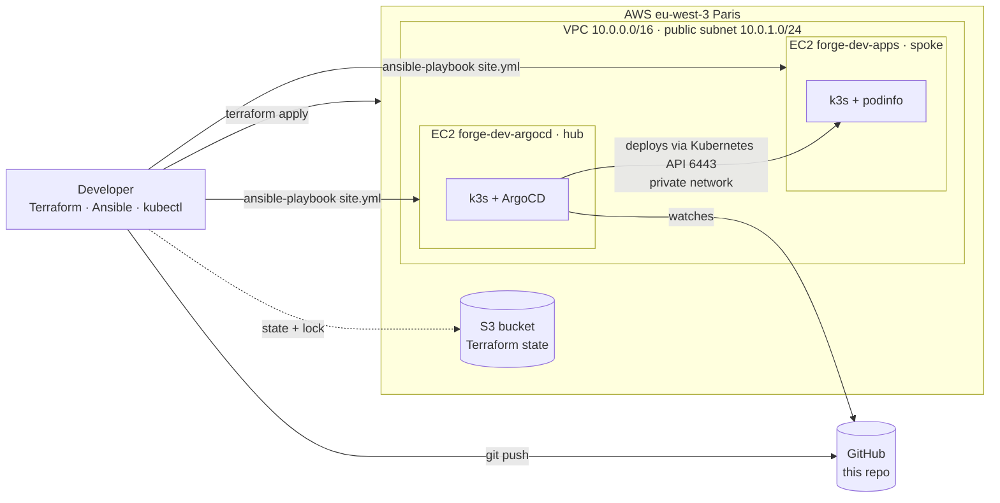

# Forge

**GitOps platform on AWS: Terraform, Ansible, k3s and ArgoCD (hub-and-spoke)**

Forge is a hands-on platform engineering project. Infrastructure is provisioned with Terraform on AWS and configured with Ansible. It runs two lightweight Kubernetes clusters in a **hub-and-spoke** layout: a management cluster running ArgoCD deploys applications from this Git repository onto a separate workload cluster, over the private network.

> 🚧 **Work in progress**: built step by step, see the [roadmap](#roadmap).

---

## Architecture (current state)



| Component | Choice | Why |
|---|---|---|
| Terraform state | S3 bucket, versioning, native locking (`use_lockfile`) | Remote, recoverable state; no DynamoDB needed (Terraform ≥ 1.10) |
| Network | 1 VPC, 1 public subnet, Internet Gateway | Minimal network; no NAT Gateway (paid, not needed for a lab) |
| Compute | 2 × EC2 `t3.small`, same reusable `k3s-node` module | Fits the AWS Free plan; one module, called once per node |
| Kubernetes | k3s installed by an idempotent Ansible role | Certified, lightweight Kubernetes |
| ArgoCD | Installed on the hub through the k3s Helm controller (dex and notifications disabled, 2 GB swap) | One file in the k3s auto-deploy folder; trimmed to fit 2 GB of RAM (measured) |
| Cluster registration | Ansible reads the spoke's credentials and writes an ArgoCD cluster Secret on the hub | Fully automated; credentials never touch Git or the terminal output |
| GitOps | ArgoCD `Application` with automated sync, `selfHeal` and `prune` | Git is the single source of truth; manual drift is reverted |
| Access | SSH (22) and Kubernetes API (6443) restricted to my IP; hub → spoke allowed by security group reference; ArgoCD UI only through `kubectl port-forward` | Least exposure; nothing is publicly reachable |

Design decisions are recorded in [`docs/decisions.md`](docs/decisions.md).

---

## Repository structure

```
forge/
├── infra/
│   ├── terraform/
│   │   ├── state-bucket/              # one-time setup: S3 bucket for the remote state
│   │   ├── modules/
│   │   │   ├── vpc/                   # VPC, public subnet, Internet Gateway, route table
│   │   │   └── k3s-node/              # EC2, Security Group, SSH key pair
│   │   └── envs/
│   │       └── dev/                   # hub + spoke nodes, hub → spoke rule, Ansible inventory
│   └── ansible/
│       ├── inventory/                 # generated by Terraform (git-ignored)
│       ├── roles/
│       │   ├── k3s/                   # installs k3s, fetches one kubeconfig per node
│       │   └── argocd/                # swap, ArgoCD (HelmChart), spoke cluster registration
│       ├── k3s.yml                    # k3s on every node
│       ├── argocd.yml                 # ArgoCD on the hub
│       └── site.yml                   # runs everything in order
├── gitops/
│   ├── argocd/                        # ArgoCD Applications (what to deploy, from where, to where)
│   └── apps/
│       └── podinfo/                   # demo app manifests (Deployment + Service)
└── docs/
    └── decisions.md                   # architecture decision records
```

---

## Getting started

**Prerequisites:** Terraform ≥ 1.10, Ansible, AWS CLI v2 with a configured profile, kubectl, an SSH key at `~/.ssh/id_ed25519.pub`.

```bash
# 1. One-time: create the state bucket
cd infra/terraform/state-bucket
terraform init && terraform apply

# 2. Network + hub and spoke nodes (also writes the Ansible inventory)
cd ../envs/dev
terraform init && terraform apply

# 3. k3s on both nodes, ArgoCD on the hub, spoke registered in ArgoCD
cd ../../../ansible
ansible-playbook -i inventory/dev.ini site.yml

# 4. Deploy the demo app (ArgoCD then keeps it in sync with Git)
export KUBECONFIG=~/.kube/forge-dev-argocd.yaml
kubectl apply -f ../../gitops/argocd/podinfo.yaml

# 5. Open the ArgoCD UI → https://localhost:8080 (user: admin)
kubectl -n argocd get secret argocd-initial-admin-secret -o jsonpath="{.data.password}" | base64 -d; echo
kubectl port-forward svc/argocd-server -n argocd 8080:443

# 6. Open the demo app → http://localhost:9898
kubectl --kubeconfig ~/.kube/forge-dev-apps.yaml port-forward -n podinfo svc/podinfo 9898:9898

# 7. Tear down when done
cd ../terraform/envs/dev && terraform destroy
```

---

## Roadmap

- [x] **Workstation**: WSL2, Docker, Terraform, AWS CLI, Ansible
- [x] **Remote state**: S3 backend with versioning and native locking
- [x] **Network**: reusable VPC module
- [x] **Compute**: reusable k3s-node module (EC2 + Security Group)
- [x] **Kubernetes**: k3s installed by an idempotent Ansible role (validated by hand first)
- [x] **Hub-and-spoke**: two nodes, private hub → spoke access on 6443
- [x] **ArgoCD**: installed on the hub with Ansible through the k3s Helm controller
- [x] **Cluster registration**: spoke registered in ArgoCD automatically by Ansible
- [x] **First GitOps app**: podinfo deployed on the spoke from Git (automated sync, selfHeal, prune)
- [ ] **App-of-apps**: every application declared in Git, no manual `kubectl apply`
- [ ] **Supply chain**: SBOM, image signing, policy rejecting unsigned images
- [ ] **Secrets**: Sealed Secrets
- [ ] **Observability**: Prometheus, Grafana

---

## Tech stack

`Terraform` · `AWS (VPC, EC2, S3, IAM)` · `Ansible` · `k3s` · `Helm` · `ArgoCD` · `Docker`

---

**Author:** Reda Chahmi, DevOps / Cloud / DevSecOps engineer