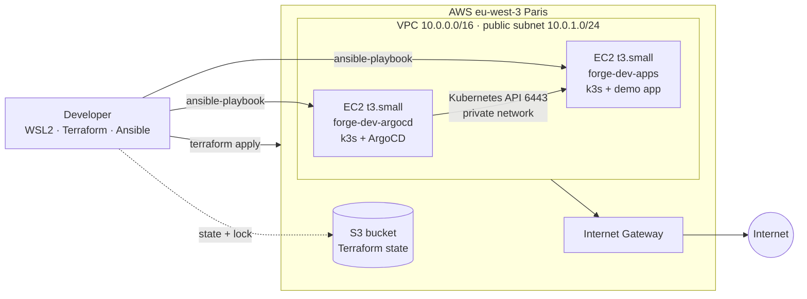

# Forge

**GitOps platform on AWS: Terraform, Ansible, k3s and ArgoCD**

Forge is a hands-on platform engineering project. Infrastructure is provisioned with Terraform on AWS, configured with Ansible, and runs two lightweight Kubernetes clusters in a **hub-and-spoke** layout: a management cluster running ArgoCD deploys applications from Git onto a separate workload cluster.

> 🚧 **Work in progress**: built step by step, see the [roadmap](#roadmap).

---

## Architecture (current state)



| Component | Choice | Why |
|---|---|---|
| Terraform state | S3 bucket, versioning, native locking (`use_lockfile`) | Remote, recoverable state; no DynamoDB needed (Terraform ≥ 1.10) |
| Network | 1 VPC, 1 public subnet, Internet Gateway | Minimal network; no NAT Gateway (paid, not needed) |
| Compute | 2 × EC2 `t3.small`, same reusable `k3s-node` module | Fits the AWS Free plan; one module, called once per node |
| Kubernetes | k3s installed by an Ansible role | Certified, lightweight Kubernetes; idempotent install |
| GitOps | Hub-and-spoke: ArgoCD on one cluster deploys to the other | Mirrors how ArgoCD manages several clusters in practice |
| Access | SSH (22) and Kubernetes API (6443) restricted to my IP; hub → spoke allowed by security group reference | Least exposure; the rule survives node re-creation |

Design decisions are recorded in [`docs/decisions.md`](docs/decisions.md).

---

## Repository structure

```
forge/
├── infra/
│   ├── terraform/
│   │   ├── state-bucket/          # one-time setup: S3 bucket for the remote state (local state)
│   │   ├── modules/
│   │   │   ├── vpc/               # VPC, public subnet, Internet Gateway, route table
│   │   │   └── k3s-node/          # EC2, Security Group, SSH key pair
│   │   └── envs/
│   │       └── dev/               # calls the modules twice (hub + spoke), writes the Ansible inventory
│   └── ansible/
│       ├── ansible.cfg
│       ├── inventory/             # generated by Terraform (git-ignored)
│       ├── roles/
│       │   └── k3s/               # installs k3s, fetches a kubeconfig per host
│       └── k3s.yml                # playbook: k3s on every node
├── gitops/                        # (in progress) ArgoCD applications
└── docs/
    └── decisions.md               # architecture decision records
```

---

## Getting started

**Prerequisites:** Terraform ≥ 1.10, Ansible, AWS CLI v2 with a configured profile, kubectl, an SSH key at `~/.ssh/id_ed25519.pub`.

```bash
# 1. One-time: create the state bucket
cd infra/terraform/state-bucket
terraform init && terraform apply

# 2. Create the network and the two nodes (also writes the Ansible inventory)
cd ../envs/dev
cp terraform.tfvars.example terraform.tfvars   # set my_ip (curl -s https://checkip.amazonaws.com)
terraform init && terraform apply

# 3. Install k3s on both nodes
cd ../../../ansible
ansible-playbook -i inventory/dev.ini k3s.yml

# 4. Talk to a cluster (one kubeconfig per node)
export KUBECONFIG=~/.kube/forge-dev-apps.yaml     # or forge-dev-argocd.yaml
kubectl get nodes

# 5. Tear down when done
cd ../terraform/envs/dev && terraform destroy
```

---

## Roadmap

- [x] **Workstation**: WSL2, Docker, Terraform, AWS CLI, Ansible
- [x] **Remote state**: S3 backend with versioning and native locking
- [x] **Network**: reusable VPC module
- [x] **Compute**: reusable k3s-node module (EC2 + Security Group)
- [x] **Kubernetes**: k3s installed by an idempotent Ansible role (validated by hand first)
- [x] **Hub-and-spoke**: two nodes, private hub → spoke access on 6443
- [ ] **GitOps**: ArgoCD on the hub, workload cluster registered, demo app deployed from Git
- [ ] **App-of-apps**: every application declared in Git, no manual `kubectl apply`
- [ ] **Supply chain**: SBOM, image signing, policy rejecting unsigned images
- [ ] **Secrets**: Sealed Secrets / Vault
- [ ] **Observability**: Prometheus, Grafana

---

## Tech stack

`Terraform` · `AWS (VPC, EC2, S3, IAM)` · `Ansible` · `k3s` · `Docker` · *in progress:* `ArgoCD`

---

**Author:** Reda Chahmi, DevOps / Cloud / DevSecOps engineer