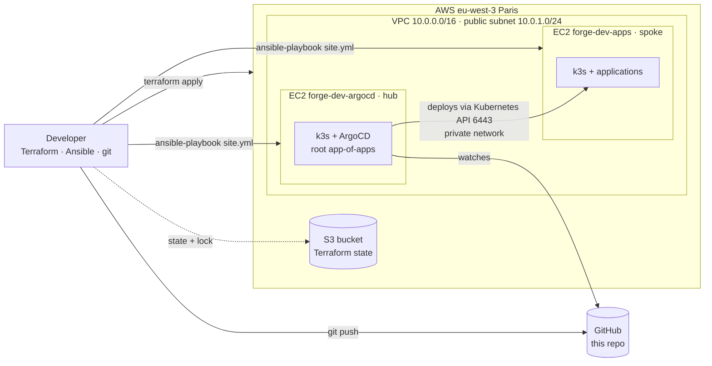

# Forge

**GitOps platform on AWS: Terraform, Ansible, k3s and ArgoCD (hub-and-spoke, app-of-apps)**

Forge is a hands-on platform engineering project. Infrastructure is provisioned with Terraform on AWS and configured with Ansible. It runs two lightweight Kubernetes clusters in a **hub-and-spoke** layout: a management cluster running ArgoCD deploys applications from this Git repository onto a separate workload cluster, over the private network.

From an empty AWS account, two commands rebuild everything, applications included. After that, every change is a `git push`.

> 🚧 **Work in progress**: built step by step, see the [roadmap](#roadmap).

---

## Architecture (current state)



### How a deployment happens

1. `terraform apply` creates the network, both nodes and the Ansible inventory.
2. `ansible-playbook site.yml` installs k3s on both nodes, installs ArgoCD on the hub, registers the spoke cluster in ArgoCD and creates a single **root** Application.
3. The root Application watches `gitops/argocd/` and creates one child Application per file.
4. Each child Application deploys its manifests from `gitops/apps/<name>/` onto the spoke.
5. From then on, adding, changing or removing an application is a commit. ArgoCD syncs automatically and reverts any manual change made in the cluster.

---

## Design decisions

| Area | Choice | Why |
|---|---|---|
| Terraform state | S3 bucket, versioning, native locking (`use_lockfile`) | Remote, recoverable state; no DynamoDB needed (Terraform ≥ 1.10) |
| Network | 1 VPC, 1 public subnet, Internet Gateway | Minimal network; no NAT Gateway (paid, not needed for a lab) |
| Compute | 2 × EC2 `t3.small`, same reusable `k3s-node` module | Fits the AWS Free plan; one module, called once per node |
| Kubernetes | k3s installed by an idempotent Ansible role | Certified, lightweight Kubernetes; install validated by hand first |
| Topology | Hub-and-spoke: ArgoCD on one cluster, workloads on the other | Mirrors how ArgoCD manages several clusters; splits the RAM load across two small nodes |
| ArgoCD install | Ansible drops a HelmChart into the k3s auto-deploy folder; dex and notifications disabled | One file, no Helm CLI; trimmed to fit 2 GB of RAM |
| Hub memory | 2 GB swap on the hub | Measured ~1.3 GB used and ~570 MB available; swap absorbs ArgoCD's spikes during syncs |
| Cluster registration | Ansible reads the spoke's credentials and writes an ArgoCD cluster Secret on the hub | Fully automated; credentials never touch Git or the terminal output (`no_log`) |
| GitOps bootstrap | App-of-apps: one root Application created by Ansible | The only bootstrap step; every other Application lives in Git |
| Sync policy | Automated sync with `selfHeal` and `prune`, resources finalizer on each app | Git is the single source of truth; removing a file removes the app and its resources |
| Access | SSH (22) and Kubernetes API (6443) restricted to my IP; hub → spoke allowed by security group reference; UIs only through `kubectl port-forward` | Nothing is publicly reachable; the SG rule survives node re-creation |

**Lab trade-offs and production targets**

- Nodes sit in a public subnet with IP-restricted access. In production: private subnets, no public IP, SSM Session Manager, NAT Gateway, ArgoCD behind an Ingress with SSO.
- ArgoCD uses the spoke's admin credentials. In production: a dedicated ServiceAccount with least-privilege RBAC.
- Each cluster is a single node. In production: three control-plane nodes for high availability, plus separate workers.

---

## Repository structure

```
forge/
├── infra/
│   ├── terraform/
│   │   ├── state-bucket/              # one-time setup: S3 bucket for the remote state
│   │   ├── modules/
│   │   │   ├── vpc/                   # VPC, public subnet, Internet Gateway, route table
│   │   │   └── k3s-node/              # EC2, Security Group, SSH key pair
│   │   └── envs/
│   │       └── dev/                   # hub + spoke nodes, hub → spoke rule, Ansible inventory
│   └── ansible/
│       ├── inventory/                 # generated by Terraform (git-ignored)
│       ├── roles/
│       │   ├── k3s/                   # installs k3s, fetches one kubeconfig per node
│       │   └── argocd/                # swap, ArgoCD, spoke registration, root Application
│       ├── k3s.yml                    # k3s on every node
│       ├── argocd.yml                 # ArgoCD on the hub
│       └── site.yml                   # runs everything in order
└── gitops/
    ├── argocd/                        # child Applications, watched by the root (one file = one app)
    └── apps/
        └── podinfo/                   # demo app manifests (Deployment + Service)
```

---

## Getting started

**Prerequisites:** Terraform ≥ 1.10, Ansible, AWS CLI v2 with a configured profile, kubectl, an SSH key at `~/.ssh/id_ed25519.pub`.

```bash
# 1. One-time: create the state bucket
cd infra/terraform/state-bucket
terraform init && terraform apply

# 2. Network + hub and spoke nodes (also writes the Ansible inventory)
cd ../envs/dev
terraform init && terraform apply

# 3. k3s on both nodes, ArgoCD on the hub, spoke registered, root Application created
cd ../../../ansible
ansible-playbook -i inventory/dev.ini site.yml
#    → nothing else to do: the root Application deploys every app in gitops/argocd/

# 4. Open the ArgoCD UI → https://localhost:8080 (user: admin)
export KUBECONFIG=~/.kube/forge-dev-argocd.yaml
kubectl -n argocd get secret argocd-initial-admin-secret -o jsonpath="{.data.password}" | base64 -d; echo
kubectl port-forward svc/argocd-server -n argocd 8080:443

# 5. Open the demo app → http://localhost:9898
kubectl --kubeconfig ~/.kube/forge-dev-apps.yaml port-forward -n podinfo svc/podinfo 9898:9898

# 6. Tear down when done
cd ../terraform/envs/dev && terraform destroy
```

### Adding an application

1. Put its manifests in `gitops/apps/<name>/`.
2. Add `gitops/argocd/<name>.yaml`, an Application pointing to that folder with `destination.name: apps`.
3. `git push`. The root Application picks it up and ArgoCD deploys it onto the spoke.

Removing the file from `gitops/argocd/` removes the application and its resources.

---

## Roadmap

- [x] **Workstation**: WSL2, Docker, Terraform, AWS CLI, Ansible
- [x] **Remote state**: S3 backend with versioning and native locking
- [x] **Network**: reusable VPC module
- [x] **Compute**: reusable k3s-node module (EC2 + Security Group)
- [x] **Kubernetes**: k3s installed by an idempotent Ansible role (validated by hand first)
- [x] **Hub-and-spoke**: two nodes, private hub → spoke access on 6443
- [x] **ArgoCD**: installed on the hub with Ansible through the k3s Helm controller
- [x] **Cluster registration**: spoke registered in ArgoCD automatically by Ansible
- [x] **First GitOps app**: podinfo deployed on the spoke from Git (automated sync, selfHeal, prune)
- [x] **App-of-apps**: root Application bootstrapped by Ansible, every app declared in Git
- [ ] **Supply chain**: CI build, Trivy scan, Cosign signing, Kyverno policy rejecting unsigned images
- [ ] **Secrets**: Sealed Secrets
- [ ] **Observability**: Prometheus, Grafana

---

## Tech stack

`Terraform` · `AWS (VPC, EC2, S3, IAM)` · `Ansible` · `k3s` · `Helm` · `ArgoCD` · `Docker`

---

**Author:** Reda Chahmi, DevOps / Cloud / DevSecOps engineer