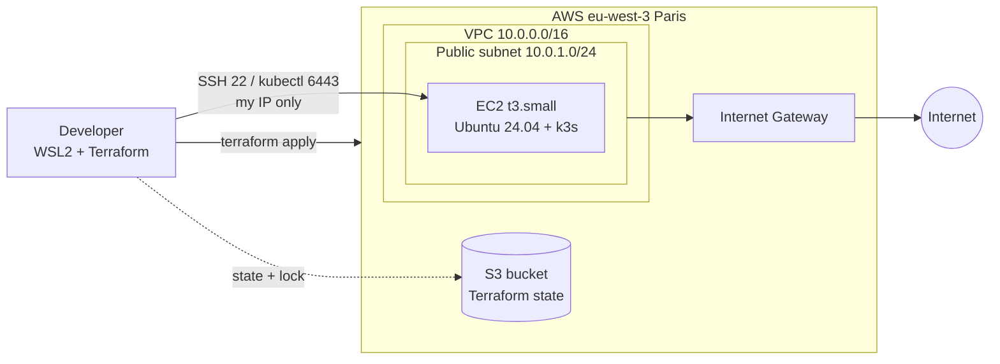

# Forge

**GitOps platform & secure software supply chain on AWS / Kubernetes**

Forge is a hands-on platform engineering project: infrastructure provisioned with Terraform on AWS, a Kubernetes cluster, GitOps delivery with ArgoCD, and a secured supply chain (SBOM, image signing, policy enforcement). The workload running on the platform is [Pitstop](#), a microservices garage-management app.

> 🚧 **Work in progress**: built step by step, see the [roadmap](#roadmap).

---

## Architecture (current state)



| Component | Choice | Why |
|---|---|---|
| Terraform state | S3 bucket, versioning, native locking (`use_lockfile`) | Remote, recoverable state; no DynamoDB needed (Terraform ≥ 1.10) |
| Network | 1 VPC, 1 public subnet, Internet Gateway | Minimal network for a single node; no NAT Gateway (paid, not needed) |
| Compute | EC2 `t3.small` running k3s | Fits the AWS Free plan; k3s is a certified, lightweight Kubernetes |
| Access | Security Group: SSH (22) and Kubernetes API (6443) restricted to my IP | Least exposure |

Design decisions are recorded in [`docs/decisions.md`](docs/decisions.md).

---

## Repository structure

```
forge/
├── infra/
│   ├── terraform/
│   │   ├── state-bucket/      # one-time setup: S3 bucket for the remote state (local state)
│   │   ├── modules/
│   │   │   ├── vpc/           # VPC, public subnet, Internet Gateway, route table
│   │   │   └── k3s-node/      # EC2, Security Group, SSH key pair
│   │   └── envs/
│   │       └── dev/           # dev environment: calls the modules, state stored in S3
│   ├── packer/                # (planned) hardened node image
│   └── ansible/               # (planned) hardening roles
├── gitops/                    # (planned) ArgoCD apps: platform + Pitstop
├── ci/                        # (planned) CI pipelines
└── docs/
    └── decisions.md           # architecture decision records
```

---

## Getting started

**Prerequisites:** Terraform ≥ 1.10, AWS CLI v2 with a configured profile, an SSH key at `~/.ssh/id_ed25519.pub`.

```bash
# 1. One-time: create the state bucket
cd infra/terraform/state-bucket
terraform init && terraform apply

# 2. Deploy the dev environment
cd ../envs/dev
cp terraform.tfvars.example terraform.tfvars   # set my_ip (curl -s https://checkip.amazonaws.com)
terraform init && terraform apply

# 3. Connect
ssh ubuntu@$(terraform output -raw k3s_public_ip)

# 4. Tear down when done
terraform destroy
```

---

## Roadmap

- [x] **Workstation**: WSL2, Docker, Terraform, AWS CLI
- [x] **Remote state**: S3 backend with versioning and native locking
- [x] **Network**: reusable VPC module
- [x] **Compute**: reusable k3s-node module (EC2 + Security Group)
- [ ] **Kubernetes**: k3s installed automatically at boot
- [ ] **GitOps**: ArgoCD (app-of-apps), Pitstop deployed to dev and prod
- [ ] **Supply chain**: SonarQube, SBOM (Syft → Dependency-Track), Cosign signing, Kyverno policy rejecting unsigned images
- [ ] **Secrets**: Vault + External Secrets Operator, Sealed Secrets
- [ ] **Observability**: Prometheus, Grafana, Loki, SLOs with error-budget alerts
- [ ] **Hardened image**: Packer + Ansible golden AMI

---

## Tech stack

`Terraform` · `AWS (VPC, EC2, S3, IAM)` · `k3s` · `Docker` · *planned:* `ArgoCD` · `Kustomize` · `Vault` · `Kyverno` · `Cosign` · `Syft` · `Dependency-Track` · `SonarQube` · `Prometheus` · `Grafana` · `Loki` · `Packer` · `Ansible`

---

**Author:** Reda Chahmi, DevOps / Cloud / DevSecOps engineer